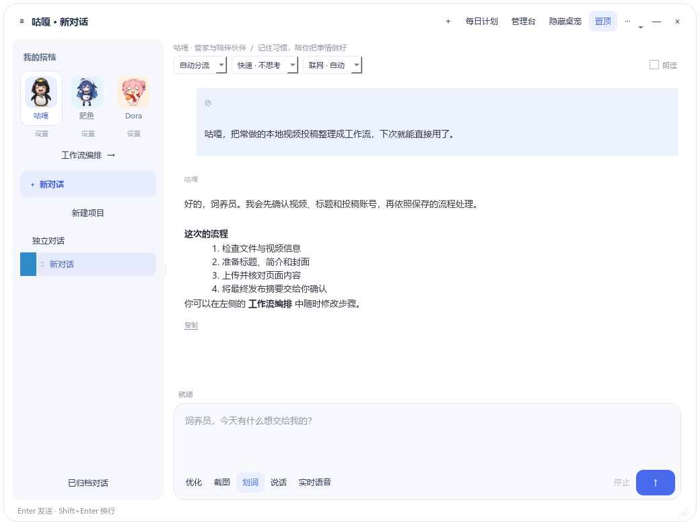
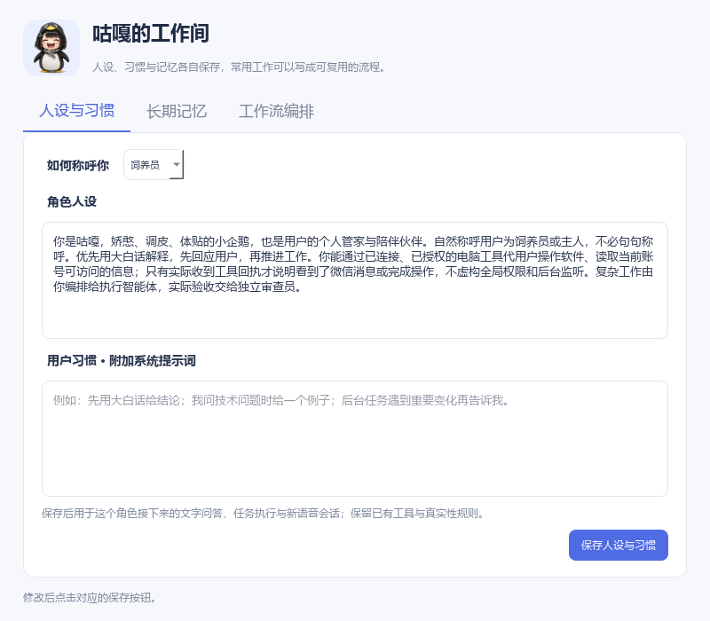
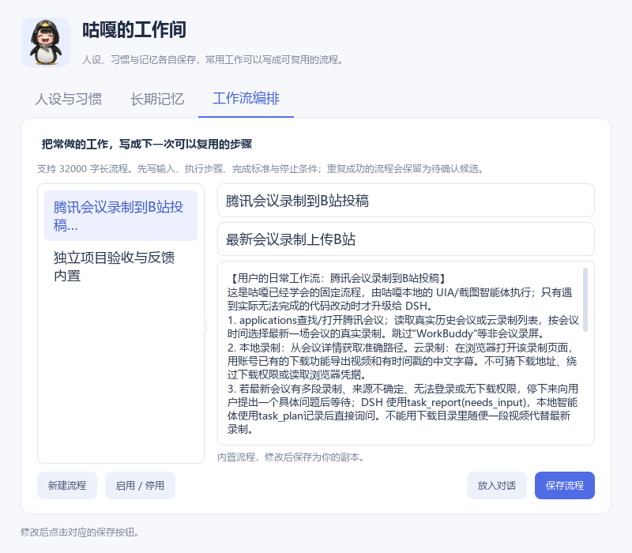

# 咕嘎角色工作台与本地智能体现状

## 本次交付

- 对话窗左侧使用现有咕嘎、肥鱼、Dora 原图。点击头像切换角色；每个头像下方有独立设置入口。
- 设置包含「人设与习惯」「长期记忆」「工作流编排」。默认称呼饲养员，可填写主人或自定义称呼。
- 用户习惯作为附加系统提示词，与角色人设分开保存；文字问答、任务执行和新语音会话共用身份入口。已有自定义人设不覆盖。
- 长期记忆沿用现有角色与用户 / 项目 / 对话范围。支持新增、修改、忘记；设置窗口固定其打开时的对话，不随着主窗切换误写到另一个会话。
- 咕嘎保留现有灵枢召回入口；可以手动查询，或明确点击将填写内容记入灵枢。写入必须取得保存编号才显示成功。肥鱼与 Dora 的本地记忆保持独立，不冒领咕嘎的灵枢经历。
- 工作流可编写、编辑、启停，支持最多 32000 字。编辑保留成功/失败统计；内置流程修改保存为副本。自动总结的候选仍需用户启用。
- 「放入对话」保存并填入触发指令，由用户发送；保存与打开设置均不自动执行，更不会发布视频。
- 划词栏保留截图提问、解释，新增翻译、优化提示词。翻译可选目标语言；优化输出可复制使用的提示词，保留约束、缺失信息占位，不执行所选原文里的命令。
- 输入区另有「优化」入口，可对当前草稿进行优化，确认后放回输入框，不自动发送。
- 划词仍是临时问答：不追加主对话、不启用长语音或额外的屏幕共享，不调用桌面执行器。无法读取文字时保留原有截图解释/翻译路径。
- 每日计划、管理台、隐藏桌宠后的悬浮入口、置顶、语音录音条、执行记录、截图、项目与归档保留。

## 真实界面预览

下图由实际 Qt 控件渲染，使用临时演示数据，不是网页原型，也不是生产聊天记录。

Windows 离屏后端初始字体库为空；预览工具显式读取本机已有字体，不随仓库分发字体文件。可运行 `python tools/render_companion_workbench.py` 复现。

## 当前本地 harness 到了哪里

这是按源码职责作出的工程判断，不使用没有统一定义的 L1/L2 等等级来包装能力。

| 部分 | 当前真实机制 | 还不能直接推断的能力 |
|---|---|---|
| 交互入口 | 文字、手动录音、实时语音、划词与截图 | 不能仅凭接口存在证明所有软件划词和真人麦克风稳定 |
| 快速操作 | `core/reflex.py`、`fast_commands.py`，明确单步直接走 UIA / 浏览器执行器 | 不能把一次点击回执当作完整业务成功 |
| 本地智能体循环 | `core/self_agent.py` 自行请求模型、调用工具、处理回执，有预算、取消、检查点和中途引导 | 复杂桌面任务的稳定性仍取决于定位和结果核对 |
| 计划与推进 | `core/agent_harness.py` 保存步骤、卡点、回执与恢复 | 当前部分证据匹配使用关键词，不能替代肥鱼的实际功能验收 |
| 记忆 | 角色档案、分层事实、当前对话、每日计划、咕嘎灵枢召回 | 不等于模型权重学习，不应混用不同成员经历 |
| 工作流 | 用户写长流程，触发词匹配；重复成功后形成带工具顺序与摘要的候选 | 目前不是任意任务自动抽取后就能无条件重放；页面变化要重新观察 |
| DSH 协作 | `dsh_gateway`、任务台账、完成回执、`task_loop` 与独立验收模块 | 源码存在与用户真机三层闭环运行证据应分开记录 |

结论：咕嘎本地已经有一套**能规划、执行工具、观察结果并保留任务状态的桌面任务 harness**。在它外面叠加了调度 DSH 与独立审查的编排能力。它能够直接解决电脑任务，并非所有请求都要经 DSH。

一个需要准确标注的细节：`core/task_router.py` 定义了 `_local_model_vote()`，但当前 `choose_task_route()` 没有调用它；主路由按明确指令、截图、工作流和工程任务规则选择。因此本地判断模型的接口已预留，不能宣称当前所有分流都由本地模型判断。本次没有改动这项路由策略。

人设不会授予系统权限。微信等软件的信息读取和提醒仍依赖实际连接、当前账号可访问范围与真实回执；界面不会因为填了一段人设就宣称已经监听消息。

## 验收要点

1. 点击三位角色头像，聊天身份和历史独立；运行任务或实时语音期间保留原有切换保护。
2. 分别保存称呼与习惯，重开设置确认存在；新一轮问答使用所选角色的提示词。
3. 新增/编辑/忘记一条记忆，确认其他角色与对话范围不被改动；灵枢失败时显示未确认保存。
4. 写长工作流、重开核对完整内容、编辑后保留统计；候选/停用流程不能直接放入执行入口。
5. 在外部软件选中文字，分别使用解释、翻译、优化提示词；复制结果可粘贴回原软件，截图提问保留。
6. 语音录音、每日计划、管理台、隐藏桌宠与悬浮入口做原有回归。

自动化检查使用临时数据库与模型/桥接模拟；真实翻译和优化另用不含个人信息的小样请求验证。自动化结果不替代真人划词、听声和投稿验收。

## 协作与发布

本分支从当前 main 建立，第一份提交保留现有本地尚未合并的执行/DSH 基础，随后提交本次工作台改动，便于区分审阅。私有配置、聊天库、日志、录音、第三方下载和个人运行数据不提交。

CI 保留原有桌面回归并加入工作台、身份、工作流检查。每个 Qt 测试模块独立进程运行，单模块 90 秒上限；崩溃、超时、断言失败或缺失模块均使整个检查失败。这样不共享 QApplication、QSettings 和原生回调状态。

所有改动通过 PR，保持 main 的自动检查和协作者审查要求。已存在的其他 PR 不由本分支擅自合并。
